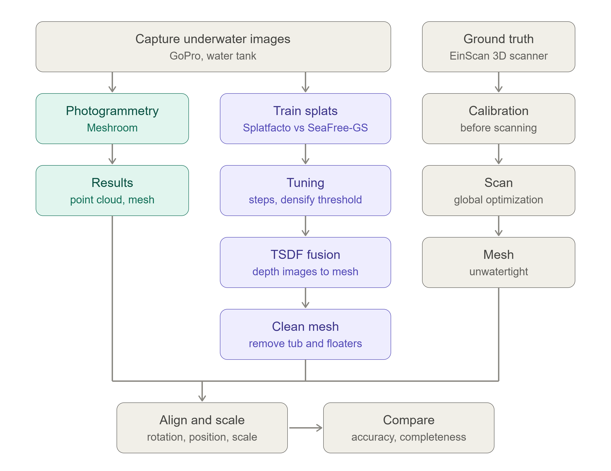

# Underwater Coral 3D Reconstruction

This project explores 3D reconstruction of an underwater coral specimen using photogrammetry and Gaussian Splatting. It compares Meshroom, Splatfacto (Nerfstudio), and SeaFree-GS.

## Project Workflow

The following diagram illustrates the complete project pipeline, from image acquisition to geometric comparison.



### Repository Structure

```text
gopro_underwater/
├── docs/                    # Documentation and supporting material
├── images/                  # Original input images
├── ply_comparison/          # Point cloud comparison results
│   ├── compare.py           # rough measurement of the coral
│   └── compare_coral.py     # align meshes and compare
├──  tsdf/                   # TSDF reconstruction outputs
│   ├── clean_mesh.py        # clean mesh after tsdf fusion
│   └── tsdf_export.py       # uses tsdf fusion
├── coral_instructions.txt   # Instructions for FFmpeg frame extraction and COLMAP commands
├── export_seafree-gs.py     # Script for exporting a .ply for the SeaFree-GS model
├── export_splats.py         # Script for exporting a .ply for the splatfacto model
├── feature_matching.py      # Script to visualise the feature matching after running colmap instructions
├── sphere.py                # Cleans everything below a certain radius, exports a cleaned mesh, .ply 
└── splatfacto.py            # Script related to the Splatfacto configuration, runs the model
   
```
## Prerequisites

The following software is required to reproduce the reconstruction workflows:

- **FFmpeg:** Used to extract frames from the GoPro video.
- **COLMAP:** Used for feature extraction, feature matching, and sparse 3D reconstruction.
- **Nerfstudio:** Used to run the Splatfacto Gaussian Splatting implementation. Installation instructions are available in the [official repository](https://github.com/nerfstudio-project/nerfstudio).
- **SeaFree-GS:** An alternative Gaussian Splatting implementation. Refer to its original repository for installation instructions.
- **Meshroom:** Used for an additional photogrammetry reconstruction workflow.
  
### Image Extraction and COLMAP
The instructions for extracting frames from the GoPro video using FFmpeg and running COLMAP are provided in coral_instructions.txt.

The COLMAP workflow includes:
- Feature extraction
- Exhaustive feature matching
- Sparse 3D reconstruction
  
After running the COLMAP commands, a folder named `colmap/` is created. It contains a `sparse/` directory, which stores the reconstructed sparse models. In this project, two models (`0` and `1`) were generated.

Each model contains the following binary files:

- `cameras.bin`: Stores the camera models and their intrinsic parameters, such as focal length and principal point.
- `images.bin`: Stores the registered images, including their camera poses (position and orientation) and 2D feature observations.
- `points3D.bin`: Stores the reconstructed 3D points, including their 3D coordinates and the image observations associated with them.
- `frames.bin`: Stores frame information.
- `rigs.bin`: Stores camera rig information.

The three main files are `cameras.bin`, `images.bin`, and `points3D.bin`. Together, they describe the camera calibration, camera poses, and sparse 3D point cloud used by subsequent reconstruction methods.

### Meshroom
Meshroom was used as an additional photogrammetry workflow. The project files, processing cache, and reconstruction outputs are included in the repository. Download it from: https://meshroom.org/ and use the images provided to create a dense reconstuction, and export the mesh using the `.ply` output format.

### Gaussian Splatting
Two existing implementations were used for Gaussian Splatting:
- Nerfstudio (Splatfacto): https://github.com/nerfstudio-project/nerfstudio
- SeaFree-GS: https://github.com/deng-ai-lab/SeaFree-GS
For installation and setup, refer to the instructions in the original repositories.
### Results
The outputs/, renders/, and ply_comparison/ folders contain the reconstruction results and evaluation outputs.
